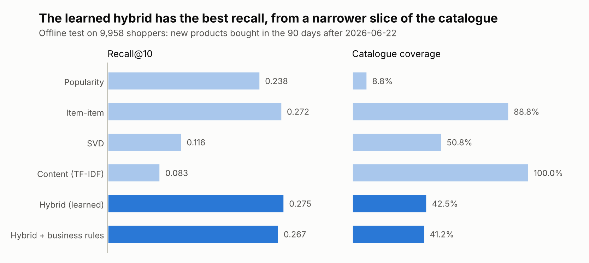
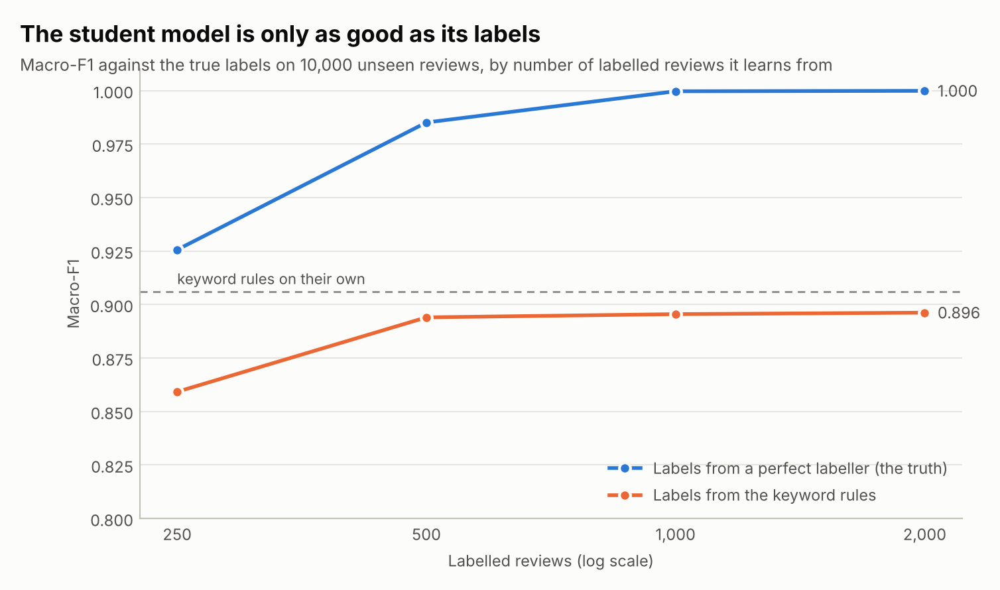
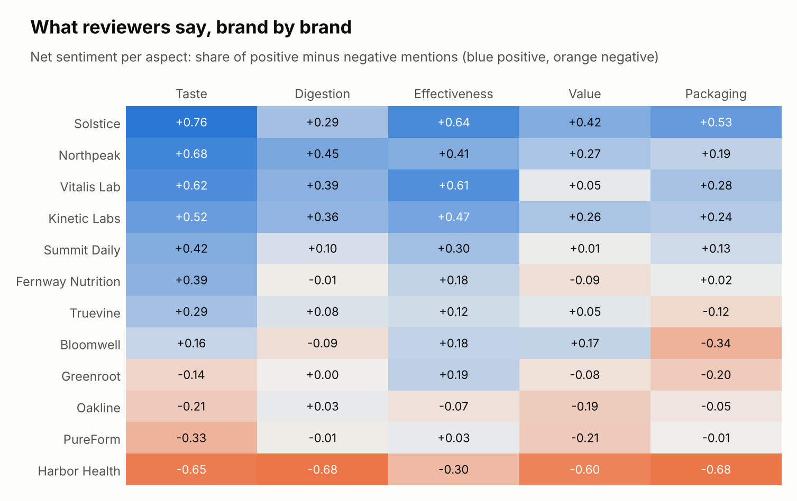
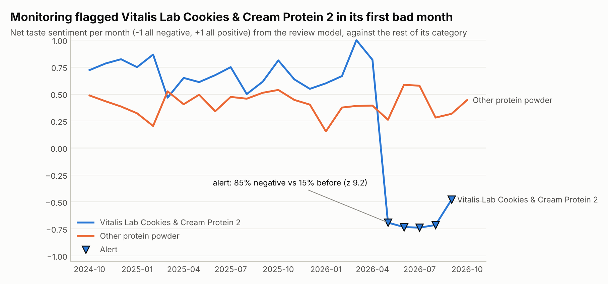
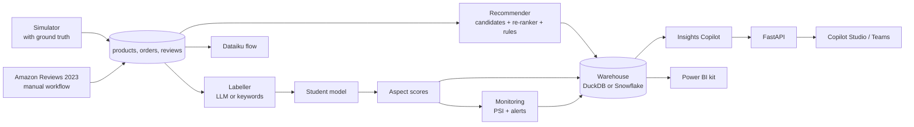
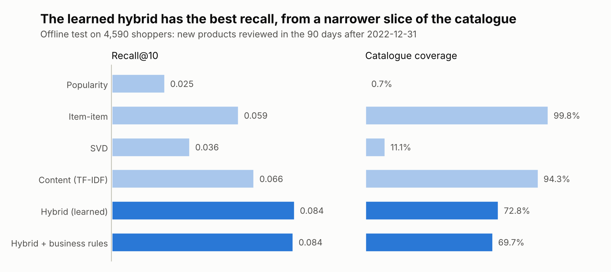

# ShelfSense Overview

[](https://github.com/faizanreza-cs/shelfsense/actions/workflows/ci.yml)


A consumer health brand's insights team asks three questions every month: what should each
shopper buy next, what are reviewers saying about taste, digestion, effectiveness, value and
packaging, and is anything going wrong? Real store data can't be shared, so this repo simulates
two years of a fictional online store, **Fernway Market**: 240 supplements from 12 brands, 29,040
shoppers, 180,530 orders and 42,285 reviews. The simulator knows each product's true quality on
every aspect and the true label of every review, and it hides one problem: a popular protein
powder is reformulated and starts to taste worse. A manual workflow runs the same pipeline on
real Amazon reviews.

## What it found

| Question | Method | Result |
|---|---|---|
| What should each shopper buy next? | Popularity, item-item, SVD and TF-IDF candidates, re-ranked by a logistic regression | Recall@10 **0.275** on the next 90 days (item-item alone 0.272, popularity 0.238) |
| What do business rules cost? | In stock only, at most 3 per brand, margin boost | Recall@10 -0.8 pts, average margin of recommendations **+1.6 pts** (30.3% to 31.9%) |
| What do reviewers say? | Keyword rules label 2,000 reviews; a TF-IDF + logistic regression model learns from them and scores all 42,285 | Macro-F1 **0.896** against the true labels; product scores track true quality (Spearman 0.94-0.96) |
| Are better labels worth it? | The same model trained on perfect labels | Macro-F1 **0.985** from just 500 labels: label quality is the limit, which is the case for LLM labels |
| Did anything go wrong? | Each product-aspect's negative share each month, against its own history | Flagged the reformulated protein in **2026-05, the month it changed** (85% negative vs 15% before), and nothing else |
| Does it hold on real data? | The same pipeline on 91,227 Amazon reviews of 1,975 supplements | Hybrid recall@10 **0.084**, **+28%** over the best single model (content, 0.066); [details](#results-on-real-reviews) |

### 1. Recommendations



Each model is fitted on purchases before 2026-06-22 and scored on the products 9,958 shoppers
bought for the first time in the next 90 days.

| Model | Recall@10 | NDCG@10 | Catalogue coverage | Average margin |
|---|---|---|---|---|
| Popularity | 0.238 | 0.132 | 8.8% | 28.2% |
| Item-item ("bought together") | 0.272 | 0.160 | 88.8% | 31.0% |
| SVD (matrix factorisation) | 0.116 | 0.057 | 50.8% | 35.3% |
| Content (TF-IDF on titles, brands, flavours) | 0.083 | 0.041 | 100% | 34.2% |
| **Hybrid** (learned re-ranker) | **0.275** | **0.161** | 42.5% | 30.3% |
| Hybrid + business rules | 0.267 | 0.158 | 41.2% | **31.9%** |

The re-ranker takes the top 30 candidates from each model and scores them with each model's
rank, popularity, price, rating, category fit and brand fit. It learns from three earlier
90-day windows, so it never sees the test period. A gradient-boosted re-ranker fitted those
windows better but did no better out of time, so the simpler model stays. The hybrid's edge
over item-item is small (+0.003), and it recommends from less than half the catalogue because
it leans on popularity. That's a trade-off worth showing to a category manager, not hiding.

### 2. What reviewers say



Every review gets a label per aspect: positive, negative or not mentioned.

| Labels from | Labelled reviews | Macro-F1 against the true labels |
|---|---|---|
| Keyword rules on their own | 2,000 | 0.906 |
| **Student model** trained on those keyword labels, scoring 40,285 reviews it never saw | 2,000 | **0.896** |
| Student trained on perfect labels | 250 / 500 / 1,000 | 0.926 / 0.985 / 1.000 |

The student copies its teacher's mistakes. In review R013810, "Gone are the days of bloating
after my shakes" is praise, but the keyword rules see "bloating" and call it a digestion
complaint, and so does the student. About a quarter of the synthetic aspect sentences are
written like that (idioms, negation, complaints without the obvious words), because real
reviews are. An LLM reads them correctly, so the intended setup is an LLM labelling a few
hundred reviews with structured output, and the cheap student scoring the rest:

```bash
shelfsense label --labeller llm -n 500 --out data/labels.csv   # Anthropic, OpenAI or Azure OpenAI
shelfsense build --labels data/labels.csv
```

`label` prints the LLM's F1 against the true labels on the synthetic store. That run needs an
API key and wasn't run for this README.



Per product, net sentiment = (positive - negative) / mentions. Against the simulator's hidden
product quality, the Spearman correlation runs from 0.94 (value) to 0.96 (taste, effectiveness,
digestion and packaging). A check that needs no labels: reviews with a negative aspect average
3.18 stars, positive-only reviews 4.47.

### 3. Monitoring



Two layers:

- **Store-level drift (PSI):** each month's mix of order categories, order prices, star ratings
  and predicted aspect labels against the first 6 months. All stayed below 0.02 (stable).
- **Product-level alerts:** every product and aspect, each month, against all earlier months
  (two-proportion z-test; at least 10 mentions, a rise of 25 points and z ≥ 4, because about
  20,000 product-aspect-months are tested).

The store-level view can't see one product among 240 going wrong. The product alert caught
Vitalis Lab Cookies & Cream Protein 2 in **2026-05, the month the simulator changed its recipe**:
85% of taste mentions were negative, against 15% before (z = 9.2). No other product or aspect
raised an alert. `shelfsense monitor` exits with code 1 when the latest month has an alert or
drift, so it can run as a scheduled job.

## What's inside

| Part | What it does | Tech |
|---|---|---|
| Simulator (`shelfsense/synth.py`) | Catalogue with hidden quality per aspect, shoppers with category tastes, brand loyalty and price sensitivity, reviews with true labels, one reformulation | Python, NumPy |
| Recommender (`shelfsense/recsys.py`) | Four candidate models, a learned re-ranker, business rules, time-split evaluation | scikit-learn, SciPy |
| Review NLP (`shelfsense/nlp.py`) | Keyword labeller, LLM labeller with structured output, TF-IDF + logistic regression student, product and monthly scores | scikit-learn, LLM APIs |
| Monitoring (`shelfsense/monitor.py`) | PSI drift and product-aspect alerts | pandas, NumPy |
| Saved queries (`shelfsense/sql/`) | Aspect scorecard by brand, monthly trend, bought together with lift, repeat purchase rate, monthly sales; rows with fewer than 50 shoppers are dropped | Snowflake SQL, run locally on DuckDB via sqlglot |
| Insights Copilot (`shelfsense/agent/`) | LLM agent that answers with the recommender, review insights, monitoring, saved queries and guarded SQL, and cites review ids | Anthropic, OpenAI, Azure OpenAI, or offline mock |
| API (`shelfsense/api.py`) | `/recommend`, `/similar`, `/insights`, `/brands`, `/monitoring`, `/metrics`, `/ask`; optional API key | FastAPI |
| Real data (`shelfsense/amazon.py`) | Amazon Reviews 2023 supplements into the same tables | httpx, pandas |
| Power BI kit (`powerbi/`) | Star-schema export, DAX measures, theme, page guide | Power BI |
| Dataiku kit (`dataiku/`) | Flow layout and Python recipes on a Snowflake connection | Dataiku |
| Copilot Studio (`copilot/`, `docs/copilot-studio.md`) | OpenAPI connector so a Copilot Studio agent can call the Insights Copilot | Microsoft Copilot Studio |



## Quickstart

```bash
git clone https://github.com/faizanreza-cs/shelfsense && cd shelfsense
make setup
make build                                   # data + every model, about a minute
shelfsense recommend C000123                 # next products for a shopper
shelfsense query bought_together             # a saved query
shelfsense monitor                           # drift and alerts for the latest month
shelfsense ask "What do reviewers say about P0015?"
make api                                     # http://localhost:8000/docs
```

`shelfsense ask` runs offline by default with a deterministic keyword router. To use a real
model:

```bash
export SHELFSENSE_PROVIDER=anthropic ANTHROPIC_API_KEY=... SHELFSENSE_MODEL=<model id>
# or SHELFSENSE_PROVIDER=azure AZURE_OPENAI_ENDPOINT=... AZURE_OPENAI_API_KEY=... SHELFSENSE_MODEL=<deployment>
# or SHELFSENSE_PROVIDER=openai OPENAI_API_KEY=... SHELFSENSE_MODEL=<model id>
```

Or with Docker: `docker build -t shelfsense . && docker run -p 8000:8000 shelfsense`.

## Real data: Amazon Reviews 2023

`shelfsense fetch` streams the Health & Household reviews and product metadata from the Amazon
Reviews 2023 dataset (McAuley Lab, UCSD) and keeps supplements. To fit a typical store, it keeps
the 2,000 most-reviewed products since 2021, shoppers with at least 3 reviews of them, and a
random sample of shoppers up to 300,000 reviews. A review counts as a purchase, the usual proxy
in this dataset. Shopper ids are replaced with `C` + a number before anything is stored. There
are no true labels, so the review model is checked against star ratings instead.

It's a large download, so it runs as a manual GitHub Actions workflow (**Actions > Real data >
Run workflow**): the metrics are printed in the log and the results and charts are saved as an
artifact. It can also run on any machine with `shelfsense fetch`. The offline tests run the same
code on the synthetic store written in the dataset's file format.

### Results on real reviews

[Run 38588922400](https://github.com/faizanreza-cs/shelfsense/actions/runs/38588922400) streamed
every Health & Household review (over 24 million) and found 2,067,424 supplement reviews of 86,407
products since 2021. The selection kept **91,227 reviews by 24,214 shoppers of 1,975 products**,
from January 2021 to September 2023. Aspect labels come from the keyword rules, because the
workflow has no API key.



| Model | Recall@10 | NDCG@10 | Catalogue coverage |
|---|---|---|---|
| Popularity | 0.025 | 0.013 | 0.7% |
| Item-item | 0.059 | 0.038 | 99.8% |
| SVD | 0.036 | 0.022 | 11.1% |
| Content | 0.066 | 0.040 | 94.3% |
| **Hybrid** (learned re-ranker) | **0.084** | **0.052** | 72.8% |
| Hybrid + at most 3 per brand | 0.084 | 0.052 | 69.7% |

- **Recommendations:** fitted on reviews up to 2022-12-31 and tested on the products 4,590
  shoppers reviewed for the first time from January to March 2023. Reviews thin out after March
  (3,214 that month, 1,133 in April, 105 in August), so the test stops at the last full month.
  The hybrid beats the best single model by **28%**, against 1% on the synthetic store. Content
  similarity is the strongest single model here, and its rank is the re-ranker's strongest input.
- **Reviews:** there are no true labels, so the check is the star rating. Reviews with a negative
  aspect average **3.64 stars**, positive-only reviews **4.58**. Effectiveness (21.6% of reviews)
  and taste (21.5%) come up most, then value (8.1%); digestion (2.3%) and packaging (0.5%)
  rarely. The keyword rules were written for the synthetic store's phrasing, so they likely miss
  real mentions; an LLM-labelled sample would measure how many (`shelfsense label --labeller llm`).
- **Monitoring:** from July 2021 to April 2023 every metric stayed stable (PSI under 0.1 against
  the first six months). All 10 flags fall in May to August 2023, as the reviews fall from 418 to
  105 a month and the mix of categories shifts (PSI 0.86 in August). On a live feed, falling
  volume with a shifting mix usually means a broken data feed, which is what this monitor is
  there to catch. No product alerts: one needs 10 mentions of an aspect for one product in a
  month, and this sample averages 1.4 reviews per product per month.

## Snowflake

All SQL is written in Snowflake's dialect. CI runs every query on DuckDB through sqlglot's
translation; on Snowflake the same files run unchanged.

1. Run [`snowflake/setup.sql`](snowflake/setup.sql). It creates a warehouse, a database, a loader
   role and a **read-only analyst role** for the agent, API and Dataiku.
2. `pip install "shelfsense[snowflake]"`, set `SNOWFLAKE_ACCOUNT`, `SNOWFLAKE_USER`,
   `SNOWFLAKE_PASSWORD` (or `SNOWFLAKE_PRIVATE_KEY_FILE`), `SNOWFLAKE_ROLE=SHELFSENSE_LOADER` and
   `SNOWFLAKE_WAREHOUSE=SHELFSENSE_WH`, then run `shelfsense load`.
3. Switch to the analyst role and `SHELFSENSE_BACKEND=snowflake`. Saved queries, `shelfsense
   sql` and the agent then run against Snowflake.
4. Optional (Enterprise Edition): the aggregation policy at the end of `setup.sql` makes
   Snowflake itself refuse to list a shopper's purchases to the analyst role.

## Power BI, Dataiku and Copilot Studio

- **Power BI:** `shelfsense export-powerbi` writes the star schema to `powerbi/data/`, with no
  shopper-level rows. [`powerbi/README.md`](powerbi/README.md) lists the relationships and the
  pages (consumer insights, product drill-through, model monitoring, recommender, sales), the
  DAX measures ([`measures.dax`](powerbi/measures.dax)) and the theme
  ([`theme.json`](powerbi/theme.json)).
- **Dataiku:** [`dataiku/README.md`](dataiku/README.md) gives the flow (recommender, review
  scoring, monitoring, SQL recipes) on a Snowflake connection, with a monthly scenario that
  alerts the category team. The recipes are thin wrappers around the tested library.
- **Copilot Studio:** [`docs/copilot-studio.md`](docs/copilot-studio.md) adds the Insights
  Copilot, product insights and recommendations to a Copilot Studio agent through a custom
  connector ([`copilot/insights-copilot.swagger.json`](copilot/insights-copilot.swagger.json)),
  so the team can ask in Teams.

## Guardrails

- **Model-written SQL** must be a single read-only SELECT on the allowed tables. Table
  functions, LATERAL, PIVOT and file or network functions are blocked, the row count is capped
  and a query is stopped after 30 seconds.
- **Shopper ids stay in the warehouse.** sqlglot resolves every column of the query, then the
  guard follows `user_id` through aliases, CTEs, subqueries, unions and `*`. It may be counted,
  grouped by, or joined on another `user_id`, but never returned, put in a function or compared
  with a value. Results are also scanned for id-shaped values, and engine errors are masked
  before the model sees them. Saved queries drop rows covering fewer than 50 shoppers, and the
  Power BI export has no shopper-level rows.
- **What the guard doesn't do:** enforce that 50-shopper minimum on ad-hoc SQL, or stop someone
  who already knows a shopper id from piecing things together over many queries. That takes an
  engine-level control, such as the optional Snowflake aggregation policy.
- **The engine is a second line of defence:** DuckDB opens read-only with external access
  disabled; on Snowflake the agent uses the read-only role.
- **The API is read-only and can require a key** (`SHELFSENSE_API_TOKEN`, `X-API-Key` header).
  The LLM provider is set by the server, never by the caller.

## Tests and evals

- **92 tests**, all offline:
  - The simulator's determinism and true labels.
  - Recommender maths by hand (similarity, NDCG, rules, new-item targets, the same tie order on
    every CPU) and the hybrid against the baselines.
  - The keyword labeller on tricky sentences, the student model, F1, and the LLM labeller and
    structured outputs with fake Anthropic and OpenAI clients.
  - PSI by hand, alerts on a spike and not on noise, and the reformulation found in the right
    month.
  - Every saved query on DuckDB, the schema against the warehouse, the SQL guard (13 ways to leak
    shopper ids, 5 legitimate uses), masked errors and the query timeout.
  - The agent's tools and providers, the API with its key check, and the real-data path on files
    in the dataset's format.
  - The Power BI measures against the exported columns, the connector against the API, the
    Dataiku recipes against the library, and the charts.
- **Agent eval** (`make eval`): 21 golden questions, with the expected tool and the facts each
  answer must contain, read from the results at eval time. The offline mock passes 21/21, which
  checks the tools and routing. Run `make eval-llm` to score a real model on the same questions.

## Limitations

- **The synthetic reviews are cleaner than real ones.** They are built from sentence templates,
  so a student trained on perfect labels reaches 1.000, which won't happen on real text. The
  keyword lexicon was written for this store's vocabulary. The comparison that matters (keyword
  labels vs better labels) holds; the absolute numbers are optimistic.
- **LLM labelling wasn't run here** (no API key in this environment). `shelfsense label` measures
  it in one command.
- **Reviews stand in for purchases** in the real-data run; real order data would be better.
- **Paths not run in CI:** the Snowflake loader, the Dataiku recipes and the Power BI report.
  They use the same tested code and SQL.

```
shelfsense/
  synth.py          simulator with ground truth
  recsys.py         candidate models, re-ranker, business rules, evaluation
  nlp.py            keyword and LLM labellers, student model, product scores
  monitor.py        PSI drift, product-aspect alerts
  sql/*.sql         saved queries (Snowflake SQL)
  warehouse.py      DuckDB / Snowflake backends
  pipeline.py       build -> warehouse + results.json
  amazon.py         Amazon Reviews 2023 -> the same tables
  agent/            Insights Copilot: providers, tools, SQL guard, loop
  evals/            golden questions + runner
  api.py · cli.py · charts.py · powerbi.py
powerbi/  dataiku/  copilot/  snowflake/  docs/
```

## Need this for your brand?

I build consumer insights and e-commerce analytics for health and CPG brands: recommendation
engines, review and survey NLP with LLMs, model monitoring, and AI assistants.

**Faizan Reza**, AI engineer · [GitHub](https://github.com/faizanreza-cs) · faizanreza01@gmail.com

## License

MIT. The store, brands, products and reviews in the synthetic data are fictional. The real-data
workflow uses the Amazon Reviews 2023 dataset (Hou et al., 2024,
[amazon-reviews-2023.github.io](https://amazon-reviews-2023.github.io/)); check its terms before
sharing derived data. Not affiliated with Amazon.
