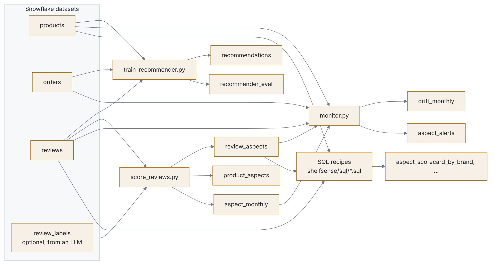

# Dataiku kit

Run shelfsense as a Dataiku flow on a Snowflake connection. The logic lives in the tested
`shelfsense` library; the recipes here only read and write Dataiku datasets.

## Flow

<picture>
  <source media="(prefers-color-scheme: dark)" srcset="../docs/img/dataiku_flow-dark.png">
  
</picture>

## Setup

1. **Data:** load the tables to Snowflake with `shelfsense load` (see `snowflake/setup.sql`),
   then create a Snowflake connection in Dataiku and import `products`, `orders` and `reviews`
   as datasets.
2. **Code environment:** a Python 3.11+ code env with
   `shelfsense @ git+https://github.com/faizanreza-cs/shelfsense`.
3. **Python recipes:** one per file in [`recipes/`](recipes), with the inputs and outputs named in
   each file's docstring. Run them in the order of the flow above.
4. **SQL recipes:** one SQL query recipe per file in [`shelfsense/sql/`](../shelfsense/sql). The
   files are already in Snowflake SQL; paste them as they are.
5. **LLM labels (optional):** run `shelfsense label --labeller llm -n 500 --out labels.csv` with an
   API key, upload the CSV as `review_labels` and add it as an input of `score_reviews.py`.
6. **Scenario:** a monthly scenario that rebuilds `aspect_alerts` recursively, then a check that
   fails when `aspect_alerts` has rows for the latest month or `drift_monthly` has a `drift`
   status, with an email reporter to the category team.
